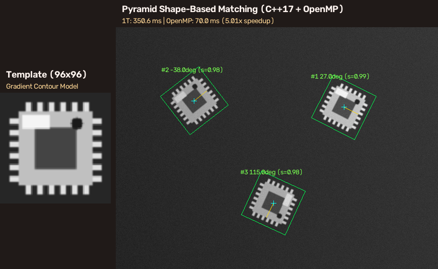
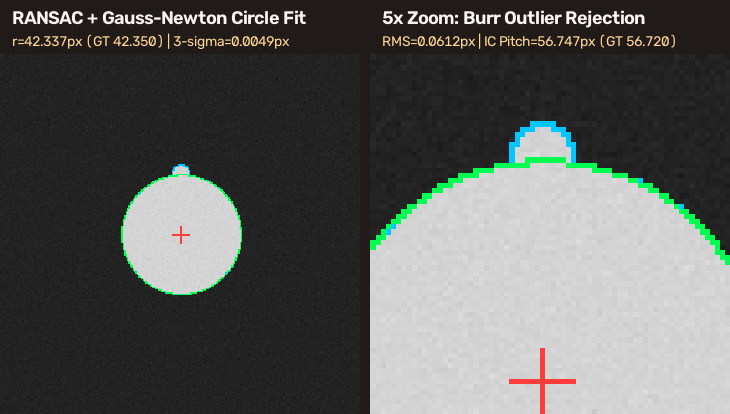
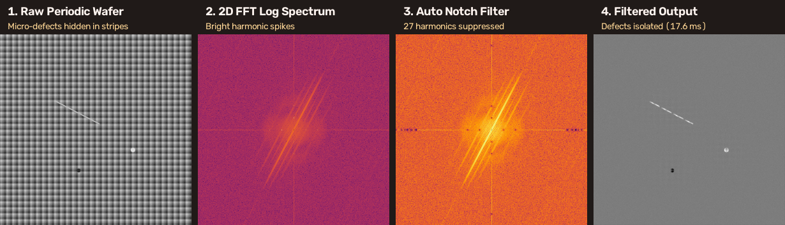
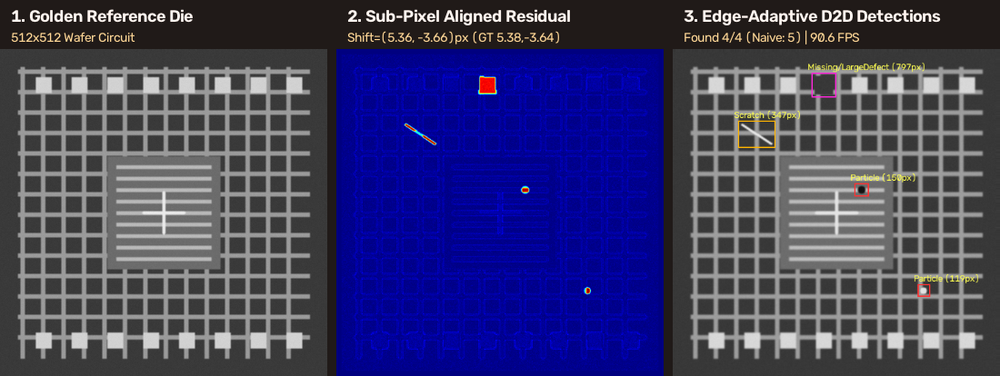

# Wafer AOI & Sub-Pixel Metrology (Pure Modern C++17 + OpenMP)

面向**半导体晶圆 / IC 封装光学量检测（AOI / Metrology）**场景的高性能视觉算法与工程框架。核心算法库（`libwafer_aoi`）采用**零第三方依赖的纯 Modern C++17 + OpenMP + ThreadPool** 从底层手写实现，覆盖半导体前道/后道检测中最核心的四大传统与精密视觉模块：

1. **金字塔梯度形状模板匹配（Pyramid Shape-Based Matching）**：复现 Halcon `find_shape_model` 核心原理，支持 $360^\circ$ 全角度旋转、光照/对比度漂移不变性、贪心早停（Greediness Early-Exit）、亚像素/亚角度抛物线精修及 OpenMP 多线程并行加速。
2. **亚像素边缘提取与鲁棒几何量测（Sub-Pixel Metrology & GR&R）**：法向非极大值抑制 + 二次插值亚像素定位，结合 **RANSAC + PCA 总最小二乘直线拟合**与 **RANSAC + Kåsa 初始化 + Gauss-Newton 几何圆拟合**，抗焊锡毛刺/缺口干扰，支持 30 次重复性精度（$3\sigma$ GR&R）评测。
3. **纯 C++ 2D-FFT 频域周期背景抑制（FFT Auto-Notch Filtering）**：手写 Radix-2 Cooley-Tukey 2D-FFT/IFFT，基于径向频环统计自动定位并滤除晶圆存储阵列周期谐波，凸显隐藏在周期条纹中的微米级划痕与颗粒。
4. **Die-to-Die (D2D) 亚像素配准与边缘自适应缺陷检测流水线**：采用 **Hann 窗正则化互功率谱 + Guizar-Sicairos (2008) 矩阵乘上采样 DFT** 实现 $<0.03\text{ px}$ 级亚像素对齐；引入**梯度自适应局部容差阈值**抑制高对比度电路边缘的过杀（Overkill），结合旋转不变 **PCA 二阶矩长宽比**区分划痕/颗粒/大面积缺失，并基于 C++17 `ThreadPool` 实现多帧高吞吐流水线。

---

## 核心实测效果与指标（Real Verified Benchmarks）

> 测试环境：Windows / MinGW-w64 `g++ 14.2.0` (`-std=c++17 -O3 -fopenmp`)，全部 12 项精度与算法单元测试通过（`12/12 PASS`）。

| 模块 | 测试场景 | 实测精度 / 检出指标 | 实测耗时 / 吞吐 |
| :--- | :--- | :--- | :--- |
| **金字塔形状模板匹配** | `640×480` 含不均匀光照梯度与噪点，3 颗任意角度 IC (`-38.5° / 27.2° / 114.6°`) | 定位误差 **`0.02 ~ 0.10 px`**，相似度 `0.98 ~ 0.99` | 单线程 `350.6 ms` → OpenMP **`70.0 ms`（`5.01×` 加速）** |
| **亚像素圆/间距量测** | 含焊锡毛刺干扰的 BGA 焊球 (`GT r=42.35 px`) & 含缺口的 IC 引脚 (`GT 56.72 px`) | 圆半径误差 **`0.013 px`**，引脚间距误差 **`0.027 px`**，30 次重复性 **`3σ = 0.0049 px`** | 单帧 **`1.91 ms`** |
| **FFT 周期背景抑制** | `512×512` 强周期晶圆条纹 + 隐藏划痕/亮暗颗粒 | 自动检测并滤除 `27` 个谐波峰，周期背景方差衰减 `>99.9%` | 单帧 **`17.58 ms`** |
| **D2D 亚像素对齐与检出** | `512×512` 晶圆 Die，亚像素偏移 `(5.38, -3.64) px` + `10%` 亮度漂移 + 4 类缺陷 | 对齐结果 `(5.36, -3.66) px`（误差 `<0.02 px`）；高敏阈值下**边缘自适应 4/4（0 过杀 0 漏检）** vs 朴素差分 5 检出（1 过杀） | 4 线程流水线 **`90.62 FPS`（`11.04 ms/die`）** |

---

### 1. 金字塔梯度形状匹配（抗旋转 + 抗不均匀光照）


### 2. 亚像素边缘量测与毛刺抗干扰（RANSAC + Gauss-Newton）


### 3. 2D-FFT 频域自动陷波滤波（晶圆周期电路背景消除）


### 4. Die-to-Die 亚像素配准、残差分析与边缘自适应缺陷分类


---

## 项目架构

```text
wafer-aoi-metrology/
├── CMakeLists.txt                   # 跨平台 CMake 构建（Linux / WSL2 / Windows）
├── Makefile                         # 零依赖快速构建（MinGW64 / GCC）
├── LEARNING_GUIDE.md                # 7 周“先跑通再倒推手撕”学习路线与 15 道面试高频题
├── include/wafer_aoi/
│   ├── image.hpp                    # 对齐内存 Image<T>、原生 PGM/PPM 无损读写与标注绘图
│   ├── image_ops.hpp                # 可分离高斯、金字塔、Sobel、双线性、形态学、Otsu、两遍并查集 CCL
│   ├── shape_matcher.hpp            # 金字塔梯度形状匹配器（贪心早停 + OpenMP）
│   ├── subpixel_metrology.hpp       # 亚像素边缘 + RANSAC/TLS 直线 + RANSAC/Gauss-Newton 圆拟合
│   ├── d2d_inspector.hpp            # 纯 C++ 2D-FFT、Guizar-Sicairos 相位相关、频域陷波、D2D 缺陷检测
│   └── thread_pool.hpp              # Modern C++17 ThreadPool 与有界生产者-消费者队列
├── src/
│   ├── core/                        # 图像容器与基础算子实现
│   ├── algo/                        # 三大核心半导体 AOI 算法实现
│   └── main_demo.cpp                # 端到端基准测试与可视化导出 CLI
├── tests/
│   └── test_all.cpp                 # 12 项精度/鲁棒性/并发单元测试
└── scripts/
    ├── generate_wafer_dataset.py    # 合成带亚像素真值的半导体晶圆/IC/BGA 测试集
    └── visualize_results.py         # 生成高对比度对比图与放大细节图
```

---

## 快速构建与运行

### 方式 A：CMake（推荐 Linux / WSL2 / Windows CMake）
```bash
cmake -B build -DCMAKE_BUILD_TYPE=Release
cmake --build build -j
ctest --test-dir build --output-on-failure
```

### 方式 B：Makefile（Windows MinGW64 / Linux GCC 开箱即用）
```bash
# 1. 编译库、单元测试与 Demo
make -j4          # Windows MinGW 下使用 mingw32-make -j4

# 2. 运行 12 项精度与并发单元测试
./build/bin/wafer_aoi_tests

# 3. 生成合成半导体数据集并运行全套基准评测
python scripts/generate_wafer_dataset.py
./build/bin/wafer_aoi_demo data/generated results

# 4. 生成可视化结果图（输出至 docs/assets/）
python scripts/visualize_results.py
```

---

## 学习与进阶指南

本项目不仅是一个可直接运行的参考工程，还配套了完整的 **[LEARNING_GUIDE.md](LEARNING_GUIDE.md)**：
* 拆解了 4 大核心模块的数学推导与代码导读顺序；
* 设计了 **6 个“删掉函数体、自己重写跑通单测”的手撕挑战**；
* 整理了 **15 道半导体量检测/AOI 面试高频追问**及本项目对应的源码级回答思路。
